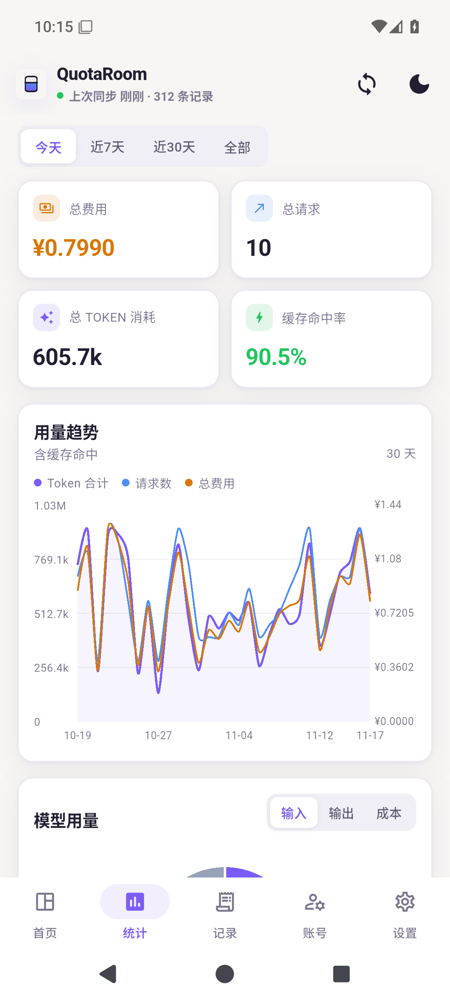
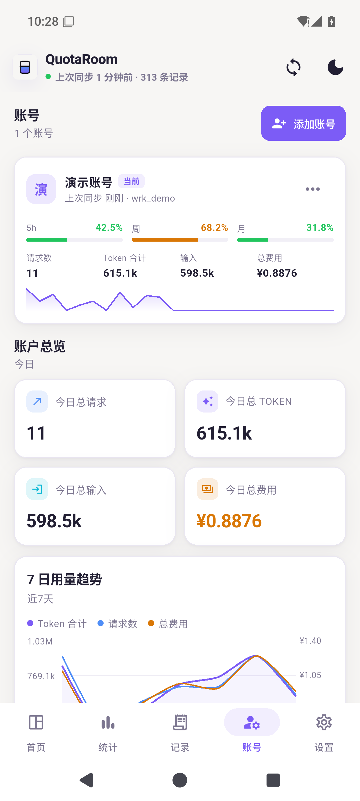
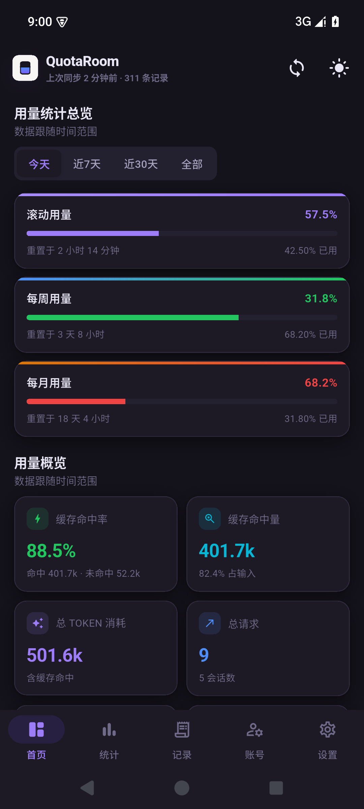
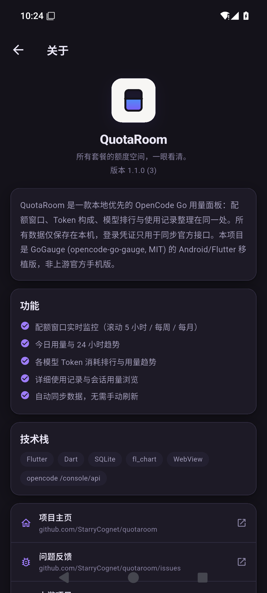

# QuotaRoom / 额度空间

[](https://github.com/StarryCognet/quotaroom/releases/latest)
[](LICENSE)
[](https://github.com/StarryCognet/quotaroom/releases/latest)

> 所有套餐的额度空间，一眼看清。

QuotaRoom 是一个本地优先的 OpenCode Go 用量面板 Android App：配额窗口、Token 构成、模型排行、使用记录集中在同一处，打开即见。它在手机本地 SQLite 中保存数据，登录凭证只用于请求 opencode.ai 官方接口。

QuotaRoom 是 [GoGauge (opencode-go-gauge)](https://github.com/yphyphyph/opencode-go-gauge) 的 **Android / Flutter 移植版与品牌重构**，按 MIT 协议开源；不是 OpenCode 或上游作者发布的官方产品。

## 截图

| 首页 | 登录 |
| --- | --- |
|  |  |

| 统计 | 记录 |
| --- | --- |
|  |  |

| Key 用量 | 账号 |
| --- | --- |
|  |  |

| 深色模式 | 关于 |
| --- | --- |
|  |  |

## 下载

- 最新版：[GitHub Releases](https://github.com/StarryCognet/quotaroom/releases/latest)
- v2.0.0 直链：[QuotaRoom-v2.0.0.apk](https://github.com/StarryCognet/quotaroom/releases/download/v2.0.0/QuotaRoom-v2.0.0.apk)
- SHA-256：`c1fe65f3be6c5a150a618a7b0c3fc29a5f0eebd3dc974b88a4cc89b92b4867c9`

> APK 使用项目固定的 release 签名（keystore 由 GitHub Actions Secrets 保存，不在仓库内），后续版本可直接覆盖升级。包名是 `com.starrycognet.quotaroom`，与旧版 GoGauge Mobile 是独立应用，可以并存。

## 更新记录

- **v2.0.0**：额度节奏 / 预计耗尽、每日预算、额度与预算本地提醒；统计页新增周期对比、模型 × Key、最贵请求 Top 5；记录页支持搜索与时间 / 模型 / Key 筛选，Key 卡片可下钻并显示 7 日 sparkline；新增 Android 桌面小组件、WorkManager 后台同步、长按快捷方式、检查更新、CSV 导出、数据库备份 / 恢复、用量摘要分享、同步日志与 AMOLED 纯黑主题。
- **v1.2.0**：记录页新增「Key 用量」Tab，按 API Key 合并请求数 / Token / 费用 / 占比 / 最后使用时间；会话与记录列表移除分页器，滚动到底自动加载更多；新增 keyStats 聚合查询与测试；版本 1.2.0。
- **v1.1.0**：UI/UX 重构——首页配额合并为紧凑三行、KPI 减到 4 个、趋势图上移；配额改为「已用% + 剩余% + 绝对重置时间」并加入健康度配色；本地数据优先渲染、配额异步刷新；首页/统计/记录/账号下拉刷新统一；记录页固定分页器 + 紧凑卡片与短时间格式；统计页改为 KPI → 趋势 → 模型 → Token 构成；账号页账户卡前置；暗色对比度、图表字号、同步状态点、首次同步提示；补充异常隔离。
- **v1.0.1**：修复登录后自动同步定时器未启动、记录/会话页同步后不刷新、退出当前账号后出现空账号面板、模型环形图超过 5 个模型时总数漏算；新增「项目主页 / 问题反馈」入口；版本号 1.0.1。
- **v1.0.0**：首个 QuotaRoom 版本。

## 来源与声明 / Source & Attribution

- 上游作者：yphyphyph
- 上游协议：MIT（见 [LICENSE](LICENSE)）
- 上游项目：<https://github.com/yphyphyph/opencode-go-gauge>
- 本仓库的改动：品牌重构为 QuotaRoom / 额度空间，使用新包名 `com.starrycognet.quotaroom` 和原创容量罐图标；用 Flutter/Dart 重写界面；把上游 Python 的 API 客户端、配额解析、SQLite 聚合、增量/全量同步游标移植到 Dart；新增 Android 内置 WebView 登录、原生 CookieManager 桥、移动端底部导航、图表、深浅色与中英切换、Keystore 凭证存储、App 内开源许可页。
- 本仓库的前身是 [StarryCognet/gogauge-mobile](https://github.com/StarryCognet/gogauge-mobile)（GoGauge Mobile v1.0.0）；QuotaRoom 使用新包名，与旧版是独立应用。
- 上游的 Windows 桌面版是独立项目，本仓库不包含桌面版代码，上游仍在独立维护。
- 通用逻辑问题欢迎同时反馈给上游；移动端适配问题请在本仓库提 issue。

This is a community-maintained Flutter/Android port and rebrand of GoGauge, not an official OpenCode or upstream release. The upstream Windows desktop application is a separate project and is not included here. See [NOTICE](NOTICE) and [LICENSE](LICENSE) for details.

**商标**：OpenCode、OpenCode Go 以及 App 中展示的模型名称/图标（DeepSeek、GLM、GPT、Grok、Kimi、Meta、MiMo、MiniMax、Qwen、Hunyuan）归各自所有者所有，仅用于标识被测服务与模型；本项目与它们没有关联或背书关系。

## 功能

- 配额空间：滚动 5 小时 / 每周 / 每月，进度条 + 剩余百分比 + 重置倒计时
- 用量概览：缓存命中率、缓存命中量、总 Token、请求数、费用（USD/CNY 实时汇率）、会话数
- 今日 24 小时输入/输出柱状图
- Token 构成：输入 / 输出 / 推理 / 缓存读 / 缓存写 / 会话数
- 模型用量环形图 + 排行，支持输入 / 输出 / 成本维度切换
- 30 天用量趋势（Token / 请求 / 费用双轴）
- 会话用量聚合（按 sessionID 分组，无 session 时按 key 拆分）
- Key 用量：按 API Key 合并请求数 / Token / 费用 / 占比 / 最后使用时间
- 请求级使用记录，滑到底自动加载 + 搜索 + 时间 / 模型 / Key 筛选
- Key 用量下钻：点按 Key 直接查看该 Key 的记录与 7 日趋势
- 额度节奏与预计耗尽时间、每日预算、额度 / 预算本地通知
- 周期对比、模型 × Key 组合排行、最贵请求 Top 5
- Android 桌面小组件、WorkManager 后台同步、长按快捷方式
- 同步日志、检查更新、CSV 导出、SQLite 备份 / 恢复、用量摘要分享
- 多账号：添加 / 切换 / 重命名 / 重新登录 / 退出 / 删除
- 自动增量同步（1/5/15/30 分钟），同步范围（30/60/90/180 天 / 全部）
- 浅色 / 深色 / 跟随系统 / AMOLED 纯黑，中文 / English，CNY / USD
- 内置 WebView 登录 + 手动粘贴 Cookie 兜底
- 数据本地优先；会话 Cookie 存放在 Android Keystore 加密存储中
- 关于页内置开源许可查看器，展示上游 MIT 文本

## 安装

从 [Releases](https://github.com/StarryCognet/quotaroom/releases/latest) 下载 APK 后直接安装（需允许「安装未知来源应用」），或：

```bash
adb install -r QuotaRoom-v2.0.0.apk
```

要求：Android 7.0+（minSdk 24），无需电脑常驻。安装后启动器名称是 **QuotaRoom**。

从源码构建时，产物位于：

```
build/app/outputs/flutter-apk/app-release.apk
```

## 登录

1. 打开 App，点「立即登录」；
2. 在内置 WebView 中完成 opencode.ai 控制台登录（Google / GitHub / 邮箱）；
3. 登录成功后会读取 `__Host-console_session` 并自动返回；
4. 首次登录会在后台全量同步最近约 30 天明细（服务端只保留 30 天）。

如果 WebView 登录无法完成（网络、2FA、风控等），使用「粘贴 Cookie 登录」：

1. 在电脑浏览器登录 <https://opencode.ai>；
2. 打开开发者工具 → Application/存储 → Cookies → `https://opencode.ai`；
3. 复制 `__Host-console_session` 的值；
4. 在 App 中粘贴 `__Host-console_session=st_...` 或直接粘贴 `st_...`。

> Cookie 等同于账号会话凭证，请勿分享。App 只把它用于请求 opencode.ai 官方接口。

## 从源码构建

环境：Flutter 3.47+、Dart 3.13+、JDK 17、Android SDK。

```bash
flutter pub get
flutter analyze
flutter test
flutter build apk --release
```

产物：`build/app/outputs/flutter-apk/app-release.apk`。

> GitHub Actions 通过 `QR_KEYSTORE_*` Secrets 使用固定 release keystore 签名。本地直接构建时若未设置这些环境变量，会回退到 debug 签名，仅适合本地安装测试。

## 开发预览（演示数据）

不需要真实账号即可查看所有页面：

```bash
flutter run -t tool/preview.dart -d <device>
```

该入口会创建一个临时演示库（`quotaroom_preview.db`），每次启动重新生成约 300 条模拟用量记录。

## 项目结构

```
lib/
  core/            主题色板、中英文案、格式化
  data/            opencode API 客户端、SQLite、同步、配额、汇率
  state/           AppState（ChangeNotifier）
  ui/              登录、底部 5 Tab、图表、开源许可页与通用组件
android/           MainActivity 中的 HttpOnly Cookie 原生桥
tool/preview.dart  仅开发用的演示数据入口
test/              API 解析、聚合口径、同步引擎测试
assets/
  icon/            QuotaRoom 容量罐图标（PNG + 源 SVG）
  LICENSE          App 内展示的 MIT 许可文本
```

关键移植来源：

- `app/opencode_api.py` → `lib/data/opencode_api.dart`
- `app/db.py` → `lib/data/*_repository.dart`（增加 `created_ms` 列，避免依赖 SQLite 的时区解析）
- `app/server.py` 的同步算法 → `lib/data/sync_service.dart`
- `app/web/app.js` 的文案与交互 → `lib/core/i18n.dart` + `lib/ui/`
- `app/web/style.css` 色板 → `lib/core/theme.dart`

## 验证

- `flutter analyze`：无问题
- `flutter test`：29 项测试全部通过（Cookie 规范化、go/status 与 request-logs 解析、401、聚合口径、Key 聚合、分页、去重、裁剪、增量游标、配额缓存）
- `flutter build apk --release`：构建成功
- 已在 Android 15 x86_64 模拟器上实测：登录页、WebView 打开 opencode.ai 登录页、首页/统计/记录/账号/设置/关于、Key 用量、滑到底自动加载、深色模式、中英切换、模型筛选、开源许可页

## 已知限制

- 仅 Android；iOS 需要另建工程（WebView Cookie 读取需 WKHTTPCookieStore 适配）。
- App 被系统杀死后不会后台同步；目前是前台定时 + 回到前台补同步。桌面版的常驻托盘行为无法等价。
- 不导入桌面版 `data/gousage.db`；首次登录从官方 API 拉取近 30 天。
- 不做上游桌面版更新检查（手机端没有对应 Release）；关于页链接到上游 GitHub。
- 登录是最脆弱环节：opencode.ai 改登录页或 Cookie 策略时需要同步调整；粘贴 Cookie 兜底始终可用。
- 官方明细接口只保留 30 天，超过 30 天的数据只能依赖本机历史累积。

## 隐私

- 用量数据保存在本机 SQLite。
- 会话 Cookie 保存在 `flutter_secure_storage`（Android Keystore）。
- 除 opencode.ai 官方接口与汇率接口 `open.er-api.com` 外，不向任何第三方发送数据。
- App 已关闭 Android 自动备份（避免恢复后 Keystore 解密失败）。

## 开源许可

本项目按 **MIT License** 开源。上游 GoGauge 的版权声明保留在 [LICENSE](LICENSE) 和 [NOTICE](NOTICE) 中，并作为 `assets/LICENSE` 打包进 APK；App 内「关于 → 开源许可」可查看完整文本。你可以自由 fork、修改、改名再发布，但需要保留上游版权与许可声明，并避免暗示官方背书。

## 致谢

- 上游项目：[yphyphyph/opencode-go-gauge](https://github.com/yphyphyph/opencode-go-gauge)（MIT）
- 数据与接口：<https://opencode.ai>
- 图表：[fl_chart](https://pub.dev/packages/fl_chart)

## 相关仓库

- 本仓库：<https://github.com/StarryCognet/quotaroom>
- 前身（GoGauge Mobile v1.0.0）：<https://github.com/StarryCognet/gogauge-mobile>
- 上游桌面版：<https://github.com/yphyphyph/opencode-go-gauge>
