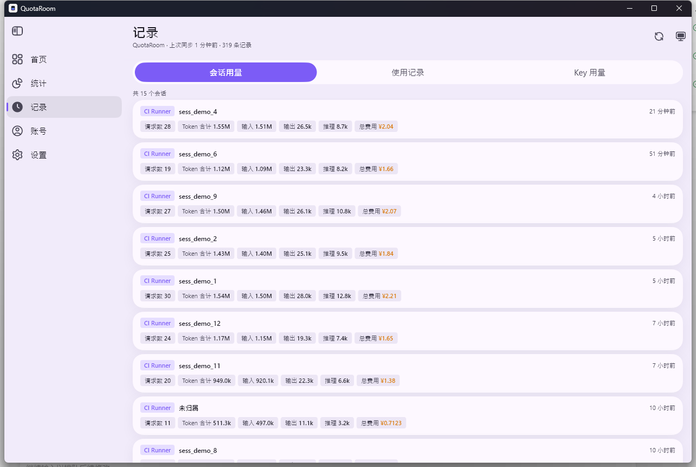
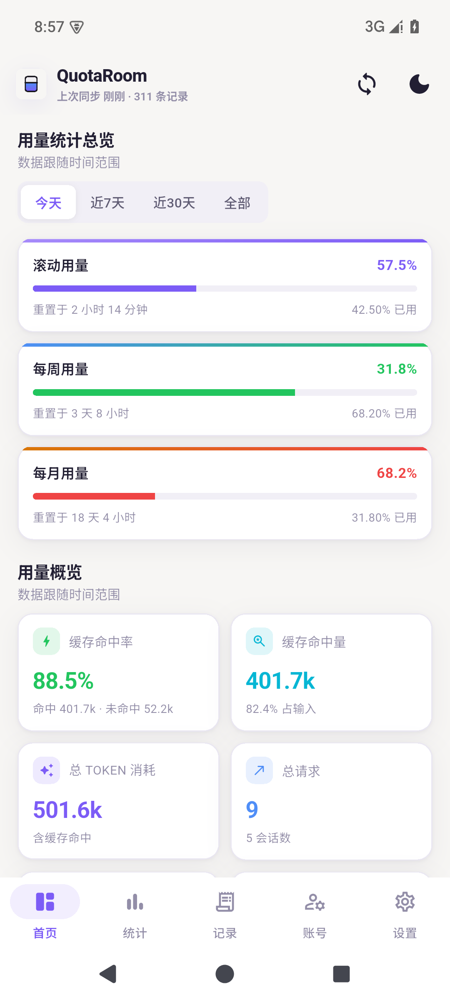
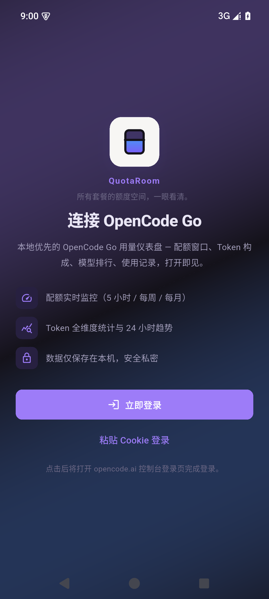
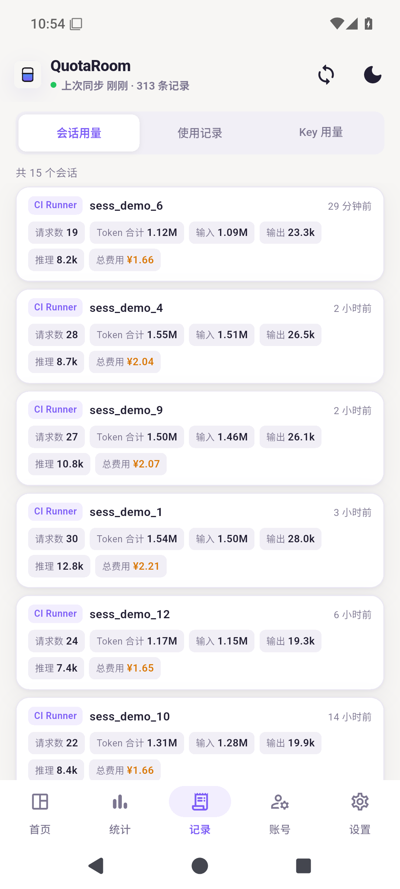
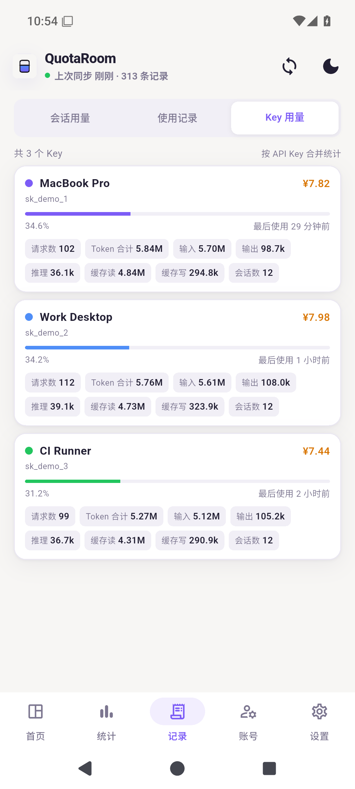

# QuotaRoom / 额度空间

[](https://github.com/StarryCognet/quotaroom/releases/latest)
[](LICENSE)
[](https://github.com/StarryCognet/quotaroom/releases/latest)

> 所有套餐的额度空间，一眼看清。

QuotaRoom 是一个本地优先的 OpenCode Go 用量面板，提供 **Android** 与 **Windows 桌面** 两个客户端：配额窗口、Token 构成、模型排行、使用记录集中在同一处，打开即见。手机和电脑共用同一套 Flutter 代码，数据分别保存在本机 SQLite 中，登录凭证只用于请求 opencode.ai 官方接口。

QuotaRoom 是 [GoGauge (opencode-go-gauge)](https://github.com/yphyphyph/opencode-go-gauge) 的 **Flutter 移植版与品牌重构**，按 MIT 协议开源；不是 OpenCode 或上游作者发布的官方产品。

## 截图



*Windows 桌面端：宽屏左侧导航，配额、概览与 24 小时趋势同屏展示。*

| 首页 | 登录 |
| --- | --- |
|  |  |

| 统计 | 记录 |
| --- | --- |
|  |  |

| Key 用量 | 账号 |
| --- | --- |
|  |  |

| 深色模式 | 关于 |
| --- | --- |
|  |  |

> 手机截图来自 Android 版；桌面截图使用独立的演示数据库生成。

## 下载

- 最新版：[GitHub Releases](https://github.com/StarryCognet/quotaroom/releases/latest)
- 从 v2.2.0 起，每个 Release 同时提供：
  - `QuotaRoom-v2.2.0.apk`：Android 7.0+ 安装包
  - `QuotaRoom-v2.2.0-windows-x64-setup.exe`：Windows 安装版
  - `QuotaRoom-v2.2.0-windows-x64.zip`：Windows 免安装便携版
  - `QuotaRoom-v2.2.0-windows-x64-single.exe`：Windows 单文件自解压版
  - `SHA256SUMS.txt` / `SHA256SUMS-windows.txt`：校验和

> APK 使用项目固定的 release 签名（keystore 由 GitHub Actions Secrets 保存，不在仓库内），后续版本可直接覆盖升级。包名是 `com.starrycognet.quotaroom`，与旧版 GoGauge Mobile 是独立应用，可以并存。Windows 版解压即用，更新时解压覆盖原目录即可。

## 更新记录

- **v2.2.0**：新增 Windows 桌面端——FFI SQLite、Windows 凭据管理器存储 Cookie、浏览器登录 + 粘贴 Cookie、宽屏左侧导航与快捷键（`Ctrl+1…5`、`Ctrl+R`/`F5`）、Windows Toast 提醒、桌面「另存为」导出、更新公告识别 Windows 便携版 zip；Android 功能、包名、签名与数据格式保持不变。
- **v2.1.1**：修正更新公告彩带动效——弹窗完全出现后再播放，时长延长到 3 秒，粒子从标题下方朝下喷洒，暗色 / AMOLED 下也清晰可见。
- **v2.1.0**：应用内更新流程——启动后每日自动检查 GitHub Release，发现新版本时弹出带彩带效果的更新公告，展示版本与更新内容；点击「下载并安装」显示实时进度并自动拉起 Android 系统安装器，首次安装引导授权「安装未知应用」；「稍后再说」后同一版本不再反复弹窗。
- **v2.0.0**：额度节奏 / 预计耗尽、每日预算、额度与预算本地提醒；统计页新增周期对比、模型 × Key、最贵请求 Top 5；记录页支持搜索与时间 / 模型 / Key 筛选，Key 卡片可下钻并显示 7 日 sparkline；新增 Android 桌面小组件、WorkManager 后台同步、长按快捷方式、检查更新、CSV 导出、数据库备份 / 恢复、用量摘要分享、同步日志与 AMOLED 纯黑主题。
- **v1.2.0**：记录页新增「Key 用量」Tab，按 API Key 合并请求数 / Token / 费用 / 占比 / 最后使用时间；会话与记录列表移除分页器，滚动到底自动加载更多；新增 keyStats 聚合查询与测试；版本 1.2.0。
- **v1.1.0**：UI/UX 重构——首页配额合并为紧凑三行、KPI 减到 4 个、趋势图上移；配额改为「已用% + 剩余% + 绝对重置时间」并加入健康度配色；本地数据优先渲染、配额异步刷新；首页/统计/记录/账号下拉刷新统一；记录页固定分页器 + 紧凑卡片与短时间格式；统计页改为 KPI → 趋势 → 模型 → Token 构成；账号页账户卡前置；暗色对比度、图表字号、同步状态点、首次同步提示；补充异常隔离。
- **v1.0.1**：修复登录后自动同步定时器未启动、记录/会话页同步后不刷新、退出当前账号后出现空账号面板、模型环形图超过 5 个模型时总数漏算；新增「项目主页 / 问题反馈」入口；版本号 1.0.1。
- **v1.0.0**：首个 QuotaRoom 版本。

## 来源与声明 / Source & Attribution

- 上游作者：yphyphyph
- 上游协议：MIT（见 [LICENSE](LICENSE)）
- 上游项目：<https://github.com/yphyphyph/opencode-go-gauge>
- 本仓库的改动：品牌重构为 QuotaRoom / 额度空间，使用新包名 `com.starrycognet.quotaroom` 和原创容量罐图标；用 Flutter/Dart 重写界面；把上游 Python 的 API 客户端、配额解析、SQLite 聚合、增量/全量同步游标移植到 Dart；新增 Android 内置 WebView 登录、原生 CookieManager 桥、移动端底部导航、图表、深浅色与中英切换、Keystore 凭证存储、App 内开源许可页。
- 本仓库在 v2.2.0 新增 Windows 桌面端：同一套 Flutter 界面增加宽屏导航、FFI SQLite、Windows 凭据管理器 / AES-GCM 凭证存储、系统浏览器 + Cookie 登录、Toast 通知与桌面导出流程。
- 本仓库的前身是 [StarryCognet/gogauge-mobile](https://github.com/StarryCognet/gogauge-mobile)（GoGauge Mobile v1.0.0）；QuotaRoom 使用新包名，与旧版是独立应用。
- 上游的 Windows 桌面版是独立项目，本仓库的 Windows 版是基于本仓库 Flutter 代码的独立实现，并非上游桌面版代码。
- 通用逻辑问题欢迎同时反馈给上游；移动端 / 桌面端适配问题请在本仓库提 issue。

This is a community-maintained Flutter port and rebrand of GoGauge, not an official OpenCode or upstream release. The Windows desktop client in this repository is an independent Flutter implementation, not the upstream Python desktop application. See [NOTICE](NOTICE) and [LICENSE](LICENSE) for details.

**商标**：OpenCode、OpenCode Go 以及 App 中展示的模型名称/图标（DeepSeek、GLM、GPT、Grok、Kimi、Meta、MiMo、MiniMax、Qwen、Hunyuan）归各自所有者所有，仅用于标识被测服务与模型；本项目与它们没有关联或背书关系。

## 功能

### Android 与 Windows 共用

- 配额空间：滚动 5 小时 / 每周 / 每月，进度条 + 剩余百分比 + 重置倒计时
- 用量概览：缓存命中率、缓存命中量、总 Token、请求数、费用（USD/CNY 实时汇率）、会话数
- 今日 24 小时输入/输出柱状图
- Token 构成：输入 / 输出 / 推理 / 缓存读 / 缓存写 / 会话数
- 模型用量环形图 + 排行，支持输入 / 输出 / 成本维度切换
- 30 天用量趋势（Token / 请求 / 费用双轴）
- 会话用量聚合（按 sessionID 分组，无 session 时按 key 拆分）
- Key 用量：按 API Key 合并请求数 / Token / 费用 / 占比 / 最后使用时间
- 请求级使用记录，滑到底自动加载 + 搜索 + 时间 / 模型 / Key 筛选
- Key 用量下钻：点按 Key 直接查看该 Key 的记录与 7 日趋势
- 额度节奏与预计耗尽时间、每日预算、额度 / 预算本地提醒
- 周期对比、模型 × Key 组合排行、最贵请求 Top 5
- 同步日志、CSV 导出、SQLite 备份 / 恢复、用量摘要
- 应用内更新检查；Android 可直接下载安装 APK，Windows 打开对应 Release 附件
- 多账号：添加 / 切换 / 重命名 / 重新登录 / 退出 / 删除
- 自动增量同步（1/5/15/30 分钟），同步范围（30/60/90/180 天 / 全部）
- 浅色 / 深色 / 跟随系统 / AMOLED 纯黑，中文 / English，CNY / USD
- 数据本地优先；登录凭证加密存储
- 关于页内置开源许可查看器，展示上游 MIT 文本

### Windows 桌面端

- 三种分发形态：安装版 `setup.exe`、便携版 zip、单文件 `single.exe`
- 窗口宽度 ≥ 840px 时自动切换左侧导航栏，内容区最大 1240px 居中
- `Ctrl+1…5` 切换首页 / 统计 / 记录 / 账号 / 设置，`Ctrl+R` / `F5` 立即同步
- 系统浏览器打开 opencode.ai，登录后粘贴 `__Host-console_session`
- Windows Toast 额度 / 预算提醒
- CSV / 数据库备份使用系统「另存为」对话框，用量摘要复制到剪贴板
- SQLite 通过 FFI 运行，数据位于 `%APPDATA%\StarryCognet\QuotaRoom\quotaroom.db`

### Android 专属

- 内置 WebView 登录 + HttpOnly Cookie 原生桥；手动粘贴 Cookie 兜底
- WorkManager 后台同步（应用被系统杀死后仍可定时同步）
- 桌面小组件、长按快捷方式
- 应用内 APK 下载与系统安装器拉起、安装权限引导

## 安装

### Android

从 [Releases](https://github.com/StarryCognet/quotaroom/releases/latest) 下载 APK 后直接安装（需允许「安装未知来源应用」），或：

```bash
adb install -r QuotaRoom-v2.2.0.apk
```

要求：Android 7.0+（minSdk 24），无需电脑常驻。安装后启动器名称是 **QuotaRoom**。

### Windows

从 [Releases](https://github.com/StarryCognet/quotaroom/releases/latest) 任选一种：

| 形态 | 文件 | 使用方式 |
| --- | --- | --- |
| 安装版 | `QuotaRoom-v2.2.0-windows-x64-setup.exe` | 双击安装，默认装到 `%LOCALAPPDATA%\Programs\QuotaRoom`，创建开始菜单 / 可选桌面快捷方式，可在「应用和功能」卸载；不需要管理员权限 |
| 便携版 | `QuotaRoom-v2.2.0-windows-x64.zip` | 解压到任意目录，运行 `QuotaRoom.exe`；更新时解压覆盖 |
| 单文件 | `QuotaRoom-v2.2.0-windows-x64-single.exe` | 只有一个 exe，双击后先自解压到临时目录再启动；首次启动可能多等几秒 |

要求：Windows 10/11 x64。三种形态共用 `%APPDATA%\StarryCognet\QuotaRoom` 下的数据库和凭证，切换形态不会丢数据。安装版卸载不会删除这份用户数据。

> Windows 可执行文件暂未做代码签名，SmartScreen 可能提示「未知发布者」，可选择「更多信息 → 仍要运行」。为了实现 Windows Toast，应用会在当前用户注册表登记 AppUserModelId（`HKCU\Software\Classes\AppUserModelId`）。

从源码构建时，产物位于：

```
build/app/outputs/flutter-apk/app-release.apk      # Android
build/windows/x64/runner/Release/QuotaRoom.exe     # Windows 原始构建
dist/QuotaRoom-<version>-windows-x64-*.zip/.exe    # Windows 三种分发形态
```

## 登录

### Android：内置浏览器

1. 打开 App，点「立即登录」；
2. 在内置 WebView 中完成 opencode.ai 控制台登录（Google / GitHub / 邮箱）；
3. 登录成功后会读取 `__Host-console_session` 并自动返回；
4. 首次登录会在后台全量同步最近约 30 天明细（服务端只保留 30 天）。

### Windows：系统浏览器 + 粘贴 Cookie

1. 点「在浏览器中登录」，系统浏览器会打开 opencode.ai；
2. 完成登录后，打开开发者工具 → Application / 存储 → Cookies → `https://opencode.ai`；
3. 复制 `__Host-console_session` 的值；
4. 回到 QuotaRoom，在对话框中粘贴 `__Host-console_session=st_...` 或直接粘贴 `st_...` 并确认。

### 任意端：手动 Cookie

如果内置浏览器 / 系统浏览器流程无法完成（网络、2FA、风控等），使用「粘贴 Cookie 登录」：

1. 在电脑浏览器登录 <https://opencode.ai>；
2. 打开开发者工具 → Application/存储 → Cookies → `https://opencode.ai`；
3. 复制 `__Host-console_session` 的值；
4. 在 App 中粘贴 `__Host-console_session=st_...` 或直接粘贴 `st_...`。

> Cookie 等同于账号会话凭证，请勿分享。App 只把它用于请求 opencode.ai 官方接口。

## 从源码构建

通用环境：Flutter 3.47+、Dart 3.13+。

### Android

需要 JDK 17、Android SDK：

```bash
flutter pub get
flutter analyze
flutter test
flutter build apk --release
```

产物：`build/app/outputs/flutter-apk/app-release.apk`。

> GitHub Actions 通过 `QR_KEYSTORE_*` Secrets 使用固定 release keystore 签名。本地直接构建时若未设置这些环境变量，会回退到 debug 签名，仅适合本地安装测试。

### Windows

需要 Visual Studio Build Tools（Windows 10/11 SDK +「使用 C++ 的桌面开发」+ **ATL** 组件）。打安装版还需要 [Inno Setup 6+](https://jrsoftware.org/isdl.php)，打单文件版需要 [7-Zip](https://www.7-zip.org/)。

```bash
flutter pub get
flutter analyze
flutter test
dart run tool/windows_plugin_links.dart   # 仅在未开启开发者模式时需要
flutter build windows --release

# 生成三种分发形态到 dist/
powershell -ExecutionPolicy Bypass -File tool/package_windows.ps1 -Version 2.2.0
```

也可以只打某一种：

```bash
powershell -ExecutionPolicy Bypass -File tool/package_windows.ps1 -Version 2.2.0 -SkipInstaller
powershell -ExecutionPolicy Bypass -File tool/package_windows.ps1 -Version 2.2.0 -SkipSingleFile
```

产物：

```
build/windows/x64/runner/Release/QuotaRoom.exe          # Flutter 原始构建
dist/QuotaRoom-2.2.0-windows-x64-setup.exe              # 安装版
dist/QuotaRoom-2.2.0-windows-x64.zip                    # 便携版
dist/QuotaRoom-2.2.0-windows-x64-single.exe             # 单文件版
dist/SHA256SUMS-windows.txt                             # 三者校验和
```

打包脚本自动查找 Inno Setup 和 7-Zip；装在非默认路径时用 `-Iscc <ISCC.exe>` / `-SevenZip <7z.exe>` 指定。

> Flutter 在 Windows 上通过符号链接引用插件。开启「设置 → 开发者选项 → 开发人员模式」后 Flutter 会自动创建；未开启时先运行 `tool/windows_plugin_links.dart`，它用目录联接（junction）完成同样的工作。若终端里有全局 `CL` 环境变量，构建前请临时移除，避免 MSVC 参数被污染。

## 开发预览（演示数据）

不需要真实账号即可查看所有页面：

```bash
# Android
flutter run -t tool/preview.dart -d <device>

# Windows
flutter run -t tool/preview.dart -d windows
```

该入口会创建一个临时演示库（`quotaroom_preview.db`），每次启动重新生成约 300 条模拟用量记录，与正式库 `quotaroom.db` 完全隔离。

## 项目结构

```
lib/
  core/            主题色板、中英文案、格式化、平台能力判断
  data/            opencode API 客户端、SQLite、同步、配额、汇率
  state/           AppState（ChangeNotifier）
  ui/              登录、导航、图表、开源许可页与通用组件
android/           MainActivity 中的 HttpOnly Cookie 原生桥
windows/           Windows runner（QuotaRoom.exe、图标、版本信息）
  installer/       Inno Setup 安装版脚本与简体中文语言文件
  sfx/             7-Zip SFX 单文件配置与 LZMA SDK 模块
tool/preview.dart  仅开发用的演示数据入口
tool/windows_plugin_links.dart  无开发者模式时的 Windows 插件目录联接
tool/package_windows.ps1        生成 zip / setup.exe / single.exe 三种形态
test/              API 解析、聚合口径、同步引擎、更新解析测试
assets/
  icon/            QuotaRoom 容量罐图标（PNG + 源 SVG）
  LICENSE          App 内展示的 MIT 许可文本
```

关键移植来源：

- `app/opencode_api.py` → `lib/data/opencode_api.dart`
- `app/db.py` → `lib/data/*_repository.dart`（增加 `created_ms` 列，避免依赖 SQLite 的时区解析）
- `app/server.py` 的同步算法 → `lib/data/sync_service.dart`
- `app/web/app.js` 的文案与交互 → `lib/core/i18n.dart` + `lib/ui/`
- `app/web/style.css` 色板 → `lib/core/theme.dart`

## 验证

- `flutter analyze`：无问题
- `flutter test`：43 项测试全部通过（Cookie 规范化、go/status 与 request-logs 解析、401、聚合口径、Key 聚合、分页、去重、裁剪、增量游标、配额缓存、更新附件解析）
- `flutter build windows --release`：构建成功，生成 `QuotaRoom.exe`
- `tool/package_windows.ps1`：便携 zip、Inno Setup 安装包、单文件 SFX 均构建成功；安装包已实测静默安装、开始菜单 / 卸载入口、启动与卸载清理；单文件已实测解压启动并在退出后清理临时目录
- Windows 实机验证：启动、浏览器登录 + Cookie 回填、Windows 凭据存储、FFI SQLite 建库、首次全量同步、首页 / 宽屏导航 / 图表 / 浅色主题
- Windows Toast 通知初始化无报错；桌面「另存为」导出、剪贴板摘要与按平台分流的更新流程已实现
- Android：v2.1.1 的登录、WebView、五个 Tab、Key 用量、滑到底加载、深色模式、中英切换、模型筛选、开源许可页均已在 Android 15 x86_64 模拟器实测；v2.2.0 的 Android 构建由 CI 继续覆盖

## 已知限制

- Windows 不使用内置 WebView 登录，需要系统浏览器 + 粘贴 Cookie；这是 Windows 上没有等价 HttpOnly Cookie 桥的取舍。
- 桌面端自动同步在应用运行期间生效；关闭窗口后不会常驻托盘或后台同步（尚未实现系统托盘）。
- Windows Toast 在未打包为 MSIX 的情况下可以显示，但系统不允许应用取消已弹出的通知或读取通知历史。
- Windows 可执行文件暂未做代码签名，SmartScreen 可能提示「未知发布者」；安装版、便携版、单文件版都如此。
- 桌面端应用内更新目前下载便携版 zip；安装版 / 单文件版用户也可以到 Release 页面选择对应附件。更新不做静默替换。
- 单文件版是自解压启动器，首次启动需要先解压 Flutter 运行时（约 30 MB），因此比便携版慢几秒；它不是真正的单二进制 Flutter 应用。
- 登录仍是最脆弱环节：opencode.ai 改登录页或 Cookie 策略时需要同步调整；粘贴 Cookie 兜底始终可用。
- 官方明细接口只保留 30 天，超过 30 天的数据只能依赖本机历史累积。
- macOS / Linux 尚未提供构建产物；Flutter 代码中的平台分支已预留，但未做发布验证。

## 隐私

- 用量数据保存在本机 SQLite：Android 应用数据库目录；Windows `%APPDATA%\StarryCognet\QuotaRoom\quotaroom.db`。
- 会话 Cookie：Android 使用 `flutter_secure_storage`（Android Keystore）；Windows 使用 Windows 凭据管理器保存密钥 + AES-GCM 加密文件。
- 除 opencode.ai 官方接口、汇率接口 `open.er-api.com` 和 GitHub Release 更新检查外，不向任何第三方发送数据；更新检查只读取版本信息。
- Android 已关闭自动备份（避免恢复后 Keystore 解密失败）；Windows 安装版 / 便携版 / 单文件版共用 `%APPDATA%\StarryCognet\QuotaRoom`，删除安装目录与该数据目录即可清除本地数据（安装版卸载不会自动删数据）。单文件版只在启动时把运行时解压到系统临时目录，退出后自动清理。Windows Toast 会在 `HKCU` 下登记 AppUserModelId，不涉及系统级修改。
- 桌面端导出的 CSV / 备份文件只写入你选择的路径，不包含登录凭证。

## 开源许可

本项目按 **MIT License** 开源。上游 GoGauge 的版权声明保留在 [LICENSE](LICENSE) 和 [NOTICE](NOTICE) 中，并作为 `assets/LICENSE` 打包进 APK；App 内「关于 → 开源许可」可查看完整文本。你可以自由 fork、修改、改名再发布，但需要保留上游版权与许可声明，并避免暗示官方背书。

## 致谢

- 上游项目：[yphyphyph/opencode-go-gauge](https://github.com/yphyphyph/opencode-go-gauge)（MIT）
- 数据与接口：<https://opencode.ai>
- 图表：[fl_chart](https://pub.dev/packages/fl_chart)
- 桌面 SQLite：[sqflite_common_ffi](https://pub.dev/packages/sqflite_common_ffi) / [sqlite3](https://pub.dev/packages/sqlite3)

## 相关仓库

- 本仓库：<https://github.com/StarryCognet/quotaroom>
- 前身（GoGauge Mobile v1.0.0）：<https://github.com/StarryCognet/gogauge-mobile>
- 上游桌面版：<https://github.com/yphyphyph/opencode-go-gauge>
